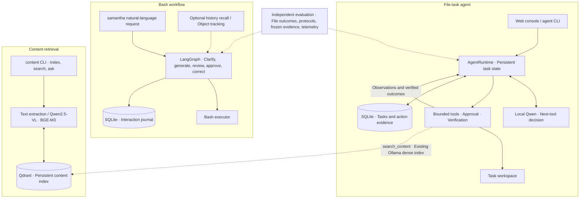

# Samantha

<p>
  <a href="./README.md"></a>
  <a href="./README.zh-CN.md"></a>
</p>

**A local file-task agent and natural-language system assistant**

Samantha uses local models to complete file tasks: it chooses the next tool from observed results, asks for approval before changes, verifies actual file outcomes, and persists task state for recovery after interruptions. Use the local web console or CLI, or continue using the original LangGraph-based natural-language Bash workflow.

[Quick start](#quick-start) · [Architecture](#architecture) · [Examples](#examples) · [Validation](#validation) · [Documentation](#documentation)

## Capabilities

| What you want to do | Current support | Entry point |
| --- | --- | --- |
| Manage workspace files | List, read, search, create, append, copy and move files; create directories | Web console / `samantha agent` |
| Review and resume tasks | Inspect exact changes, approve each action, answer clarifications, stop tasks and reconcile interrupted actions | Web console / `samantha agent resume` |
| Continue a previous file task | Explicitly link a parent task and reuse verified action evidence; approve new changes separately | Web follow-up action / `--parent-id` |
| Find information by content | Text, DOCX, PDF and image understanding, semantic search, metadata filters and answers with sources | `samantha content` |
| Operate Linux through natural language | Clarification, command generation, independent model review, human approval and bounded correction | `samantha "request"` |
| Inspect history and file objects | Persistent interaction logs; optional history recall and verified file-object tracking | `samantha history` / `samantha entities` |

The file-task agent uses bounded tools inside a workspace. The Bash workflow handles Linux / openEuler command tasks. Their state, tool scope and recovery capabilities are described separately below.

## Quick start

Run the following commands from the repository root. Start **Ollama** on the host; Samantha defaults to **`qwen3:4b`**. If the model is not installed yet:

```bash
ollama pull qwen3:4b
```

### Docker / openEuler

With Docker Compose available, the Docker engine running and Ollama running on the host, start the console:

```bash
docker compose up -d --build oe
```

Open **<http://127.0.0.1:8765>**. The container runs openEuler. Task databases and files persist through the `./work:/work` bind mount.

```bash
docker compose logs -f oe     # View service logs
docker compose exec oe bash  # Open a shell with the samantha command
docker compose stop oe       # Stop the service and retain task data
```

The container connects to the host model at `http://host.docker.internal:11434/v1` by default. If an existing `.env` or environment variable overrides `QWEN_BASE_URL`, use an address reachable from the container: `127.0.0.1` inside the container refers to the container itself. See the [setup guide](readme_help/how_to_use_Samantha.md) for connection troubleshooting.

### Local Python

Requires **Python 3.10+**. The web console and file-task CLI can run on Windows; the original Bash workflow requires Linux / Bash. Skip environment creation and dependency installation if you already have them.

<details>
<summary>Windows / PowerShell</summary>

```powershell
python -m venv .venv
.\.venv\Scripts\python.exe -m pip install -r work/requirements.txt
$env:QWEN_API_MODE = "ollama"
.\.venv\Scripts\python.exe work/src/samantha.py serve
```

</details>

<details>
<summary>Linux / openEuler / Bash</summary>

```bash
python3 -m venv .venv
source .venv/bin/activate
python3 -m pip install -r work/requirements.txt
export QWEN_API_MODE=ollama
python3 work/src/samantha.py serve
```

</details>

Open **<http://127.0.0.1:8765>**. The console currently has a Chinese interface and requires no Node.js or frontend build. The default host model endpoint is `http://127.0.0.1:11434/v1`; the examples explicitly select Ollama's native API, matching Compose.

| Default location | Purpose |
| --- | --- |
| `work/.samantha/workspace/` | Files managed through the web console |
| `work/.samantha/tasks.sqlite3` | File tasks, actions, approvals and events |

Use `serve --workspace <directory>` to choose a workspace and `SAMANTHA_TASK_DB` to choose a database. Unlike the console, `agent run` defaults to the current working directory; pass `--workspace` explicitly. See [`.env.example`](.env.example) for configuration and the [file-task agent guide](readme_help/durable_task_agent.md) for more commands.

The console binds to loopback by default, and Compose publishes its port only on the host's loopback interface. It has no login authentication and is intended for local use.

## Architecture

The system has two independent execution paths, alongside content retrieval, history and evaluation modules. **The file-task agent uses an application state machine and SQLite; the original shell workflow uses LangGraph.**



### File tasks: choose, approve, execute, verify, continue

On each turn, the model selects one tool, asks for clarification or reports completion. The runtime validates the structure and arguments and feeds tool results back to the model. Each write is bound to an exact action and the file's prior state, requires approval, and is followed by checks of actual bytes, hashes and paths.

SQLite preserves task and action state. After a restart, use the console's resume action or `agent resume`: effects already applied and verified are recorded without repeating an append. Partial effects or conflicting file changes cause a stop with evidence retained. Restarting the service does not automatically replay tasks, and a later failure does not roll back completed operations.

The web console, CLI and task evaluations share [`AgentRuntime`](work/src/task_agent/runtime.py). See the [file-task agent guide](readme_help/durable_task_agent.md) for tool contracts and recovery semantics.

Optional `--intent-mode hierarchical` adds one structured intent call before planning, with durable accounting and bounded fallback. The original request, all tools and per-action approvals remain authoritative. Baseline remains the default; see the [intent contract and comparison protocol](readme_help/hierarchical_intent.md). This is separate from model routing and does not establish an accuracy improvement.

### Bash workflow: fixed roles and conditional routing

The original path follows clarification → intent parsing → command generation → independent review → human approval → Bash execution. Failures allow up to three corrections; every new command sequence is reviewed and approved again.

LangGraph checkpoints currently live in process memory. SQLite interaction logs survive restarts but do not resume the graph. `history` reads the interaction journal, while `agent show` reads new task state; these records cannot be converted into each other's resumable tasks. History recall and object tracking are optional features of the original path. New agent follow-ups use explicit parent-task evidence. See the [LangGraph workflow guide](readme_help/langgraph_workflow.md).

### Content retrieval: explicit indexing and task integration

The pipeline is text extraction / Qwen2.5-VL visual understanding → chunks, summaries and tags → BGE-M3 → Qdrant → retrieval / answers with sources. The standalone CLI supports FlagEmbedding dense+sparse hybrid retrieval and Ollama dense retrieval.

The file-task agent's `search_content` currently queries **an existing Ollama dense index**, filters results to its workspace, and does not automatically index files or download models. Filename and text searches use `search_files` without a vector index. See the [content search guide](readme_help/content_search.md) for installation and backend selection.

## Examples

### Complete your first task in the console

1. Enter: "Create notes.txt containing alpha followed by a newline."
2. Inspect the pending action's path and exact content, approve it, then check the file verification result.
3. Once the task ends, click **继续这个话题** (continue this topic) and enter: "Append beta followed by a newline to the file we just created."
4. Approve the append and inspect the output. Follow-ups inherit verified evidence; each new change needs fresh approval.

### Run and resume from the CLI

Run this Bash example from the repository root with your Python environment activated. On Windows, create the workspace directory first and replace `python3` with `.\.venv\Scripts\python.exe`.

```bash
mkdir -p work/.samantha/workspace
python3 work/src/samantha.py agent run "Create notes.txt containing hello" --workspace work/.samantha/workspace --interactive

python3 work/src/samantha.py agent list
python3 work/src/samantha.py agent show TASK_ID
python3 work/src/samantha.py agent resume TASK_ID --interactive
```

Replace `TASK_ID` with an actual task ID. Without `--interactive`, a task returns persisted state as JSON when it needs clarification or approval; continue with `agent answer` or `agent approve`.

### Content search and the original terminal entry point

This example uses Linux / Bash. First prepare the vision model and embedding backend using the [content search guide](readme_help/content_search.md). Here, `./documents` is an existing directory of source files.

```bash
source work/samantha.sh

samantha content doctor
samantha content index ./documents
samantha content search "contract payment terms"
samantha content ask "When is payment due under the contract?"

samantha "List Markdown files in the current directory"
samantha history list
```

`history` supports inspection and export of interaction logs. With object tracking enabled, `samantha entities` lists saved file objects. See [interaction logging](readme_help/interaction_logging.md) and [object tracking](readme_help/object_tracking.md).

## Validation

These results come from the **saved validation record dated 2026-10-13**. Each layer answers a different question.

| Validation layer | Recorded result | Scope |
| --- | --- | --- |
| Full Windows regression suite | 622 tests: 619 passed, 3 skipped | Code, protocols, budgets, recovery and HTTP integration |
| Scripted planner with real file tools | 10 scenarios run twice; 20/20 passed; 0 model requests | 14 file-task runs and 6 rejection, conflict or workspace-boundary protocol checks |
| Final local Qwen3 4B acceptance | 3/3 passed; 13 physical model requests | File creation, interrupted append recovery, and copy-then-move; public development tasks |

The live acceptance run covers only three development tasks and is not a general task-success estimate. Earlier failures, timeouts and truncated-output attempts are also preserved, bringing the historical experiment total to 29 model requests. File outcomes and complete task success are scored separately: the runtime's `succeeded` status alone does not independently establish that the whole user goal was met.

See the [validation record and failure analysis](readme_help/task_agent_validation_20261013.md) and the [committed validation summary](work/evals/results/task_agent_validation_20261013.json). Full raw artifacts live under the Git-ignored `work/.test-results/` and are not included in a clone. That validation included HTTP integration tests, but not browser clicks or visual acceptance, and did not verify a remote Linux CI run.

A separate [local model routing experiment](readme_help/model_routing_results_20261012.md) compares five strategies on 12 held-out tasks, for 60 held-out attempts. It is a bounded-tool experiment, has not established a quality benefit from intelligent model selection, and is not connected to the default task execution path.

### Run offline checks

After installing the base dependencies, run from the repository root:

```bash
python3 -m unittest discover -s work/tests -p 'test_*.py' -q

# Scripted planner and real file tools in fresh isolated fixtures; no model calls.
cd work
python3 -m evals.task_agent_eval --repeats 2
```

On Windows, use the virtual environment's Python; after entering `work`, its relative path is `..\.venv\Scripts\python.exe`. Live task evaluation requires the explicit `--live` flag; see the [task evaluation guide](readme_help/durable_task_agent.md#任务级评测) for commands and budgets. The [offline CI configuration](.github/workflows/offline-eval.yml) isolates external networking after dependency installation, retaining loopback for local HTTP tests.

## Repository layout

```text
work/
├── src/
│   ├── samantha.py          # CLI entry point and original terminal adapter
│   ├── task_agent/          # Runtime, tools, planner, SQLite, web and static UI
│   ├── workflow.py          # LangGraph command workflow
│   ├── content_search/      # Extraction, models, indexing and retrieval
│   ├── agent_memory/        # Optional history recall backends
│   ├── object_tracking/     # Verified file objects and cross-invocation references
│   ├── interaction_log.py   # Persistent interaction journal
│   ├── observability/       # Events, redaction and optional export
│   └── prompts/             # Versioned prompt registry
├── evals/                   # Task evaluation, routing experiments and saved summaries
└── tests/                   # Regression tests and real-task acceptance tools
readme_help/                 # Guides, validation records and historical demos
```

## Documentation

The README is available in English and [Simplified Chinese](README.zh-CN.md). Detailed guides retain their original languages; several are currently in Chinese.

| Topic | Guide |
| --- | --- |
| File tasks and console | [Tools, approvals, recovery, CLI and task evaluation](readme_help/durable_task_agent.md) |
| Setup and terminal use | [Linux / openEuler setup and model connections](readme_help/how_to_use_Samantha.md) · [Shell function](readme_help/use_shell_function.md) |
| Bash workflow | [LangGraph state, routing and independent command review](readme_help/langgraph_workflow.md) |
| Content search | [Models, hybrid / dense modes and index configuration](readme_help/content_search.md) |
| History and memory | [Interaction logging](readme_help/interaction_logging.md) · [History recall experiments](readme_help/memory_experiments.md) · [Object tracking](readme_help/object_tracking.md) |
| Task acceptance | [Latest agent validation](readme_help/task_agent_validation_20261013.md) · [Original 25-task acceptance protocol](readme_help/real_task_evaluation.md) |
| Evaluation system | [Frozen evidence, scoring, regrading and observability](readme_help/evaluation_system.md) |
| Model routing | [Experiment protocol](readme_help/model_routing_experiments.md) · [2026-10-12 results and scope](readme_help/model_routing_results_20261012.md) |
| Future design and project history | [Small-model multi-turn plan](readme_help/small_model_multiturn_plan.md) · [Early terminal demos](readme_help/legacy_demo.md) |

## Limitations and roadmap

- **Tool scope:** The file-task agent has no general Bash or deletion tool. Files are currently limited to 1 MiB, and text reads return at most 32 KiB. Path restrictions and approvals are application-level controls, not an OS sandbox.
- **Recovery scope:** The new agent reconciles interrupted actions but does not provide cross-file transactions or automatic rollback. Cross-process recovery for the original Bash workflow remains future work. Use one task service and database per workspace.
- **Models and context:** Current acceptance coverage is small; longer tasks, multi-turn context and independent held-out evaluations need further work. History recall, file-object records and parent-task evidence have separate scopes and do not yet form a unified long-term memory.
- **Retrieval and synchronization:** Persistent Qdrant retrieval is implemented. Automatic index updates after file moves or deletions, and visual-similarity embeddings, remain extensions.
- **Integration validation:** Browser interaction, cross-platform behavior and optional Langfuse / Inspect integrations need further live validation. Offline mocks do not replace external-service acceptance tests.

## Team and project background

Samantha began as NottingDuck's natural-language terminal assistant for openEuler (`track1_nottingDuck`) and has expanded into content retrieval, durable file tasks and an evaluation system. Early Tier 1/2/3 screenshots and design diagrams are preserved in the [historical demos](readme_help/legacy_demo.md). This page and the linked guides describe the current implementation.

- [Shuli Wang](https://github.com/NingShuZhu)
- [Yujie Yao](https://github.com/JackyYao1021)
- [Ningbo Wei](https://github.com/NingboWEI)
