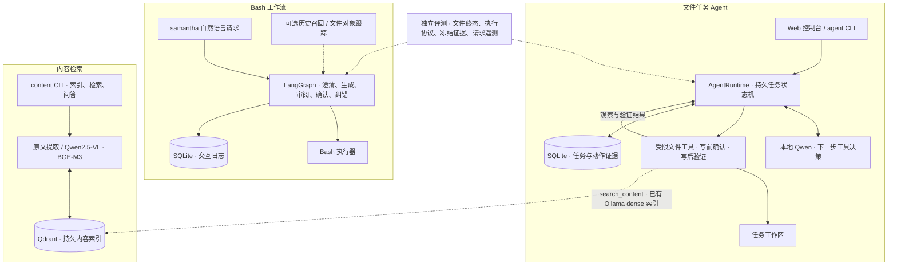

# Samantha

<p>
  <a href="./README.md"></a>
  <a href="./README.zh-CN.md"></a>
</p>

**本地文件任务 Agent 与自然语言系统助手**

Samantha 使用本地模型完成文件任务：根据工具结果选择下一步，在文件变更前请求确认，执行后验证实际产物，并保存任务状态以支持中断恢复。你可以通过本地 Web 控制台或 CLI 操作，也可以继续使用基于 LangGraph 的自然语言 Bash 工作流。

[快速开始](#快速开始) · [当前架构](#当前架构) · [使用示例](#使用示例) · [验证结果](#验证结果) · [文档导航](#文档导航)

## 核心能力

| 你想完成的工作 | 当前能力 | 入口 |
| --- | --- | --- |
| 管理工作区文件 | 列出、读取、搜索、创建、追加、复制、移动文件及创建目录 | Web 控制台 / `samantha agent` |
| 审阅并继续任务 | 查看精确变更、逐次确认、回答澄清、停止任务、核对中断现场后恢复 | Web 控制台 / `samantha agent resume` |
| 延续上一次文件任务 | 显式关联父任务，引用已验证操作证据；新变更重新确认 | Web「继续这个话题」/ `--parent-id` |
| 按内容查找资料 | 文本、DOCX、PDF、图片理解，语义检索、元数据过滤及带来源问答 | `samantha content` |
| 用自然语言操作 Linux | 澄清、生成命令、独立模型审阅、人工确认与有界纠错 | `samantha "请求"` |
| 查阅历史与文件对象 | 持久交互日志；可选的历史召回和已验证文件对象跟踪 | `samantha history` / `samantha entities` |

文件任务 Agent 使用工作区内的受限文件工具；Bash 工作流适用于 Linux / openEuler 命令任务。两者的状态、工具范围和恢复能力分别说明如下。

## 快速开始

以下命令从仓库根目录运行。准备运行中的 **Ollama**，默认模型为 **`qwen3:4b`**；尚未安装模型时执行：

```bash
ollama pull qwen3:4b
```

### Docker / openEuler

安装并启动 Docker Compose，在宿主机运行 Ollama，然后启动控制台：

```bash
docker compose up -d --build oe
```

打开 **<http://127.0.0.1:8765>**。容器使用 openEuler，任务数据库和文件通过 `./work:/work` 挂载保留。

```bash
docker compose logs -f oe     # 查看服务日志
docker compose exec oe bash  # 进入交互终端，可使用 samantha 命令
docker compose stop oe       # 停止服务，保留任务数据
```

容器默认通过 `http://host.docker.internal:11434/v1` 连接宿主机模型。若已有 `.env` 或环境变量覆盖 `QWEN_BASE_URL`，请使用容器可访问的地址；容器中的 `127.0.0.1` 指向容器自身。连接排查见[安装指南](readme_help/how_to_use_Samantha.md)。

### 本地 Python

需要 **Python 3.10+**。Web 和文件任务 CLI 可在 Windows 上运行；原有 Bash 工作流需要 Linux / Bash。已有虚拟环境和依赖时，可跳过创建与安装步骤。

<details>
<summary>Windows / PowerShell</summary>

```powershell
python -m venv .venv
.\.venv\Scripts\python.exe -m pip install -r work/requirements.txt
$env:QWEN_API_MODE = "ollama"
.\.venv\Scripts\python.exe work/src/samantha.py serve
```

</details>

<details>
<summary>Linux / openEuler / Bash</summary>

```bash
python3 -m venv .venv
source .venv/bin/activate
python3 -m pip install -r work/requirements.txt
export QWEN_API_MODE=ollama
python3 work/src/samantha.py serve
```

</details>

打开 **<http://127.0.0.1:8765>**。控制台无需 Node 或前端构建。宿主机模型地址默认是 `http://127.0.0.1:11434/v1`；上面的配置显式使用 Ollama 原生接口，与 Compose 一致。

| 默认位置 | 用途 |
| --- | --- |
| `work/.samantha/workspace/` | Web 控制台操作的文件目录 |
| `work/.samantha/tasks.sqlite3` | 文件任务、动作、确认和事件记录 |

可通过 `serve --workspace <目录>` 指定工作区，通过 `SAMANTHA_TASK_DB` 指定数据库。`agent run` 的默认工作区是调用时的当前目录，建议显式传入 `--workspace`。配置参考 [`.env.example`](.env.example)，更多命令见[文件任务 Agent 指南](readme_help/durable_task_agent.md)。

控制台默认仅监听本机；Compose 也只向宿主机回环地址发布端口。当前没有登录认证，应保持本地使用。

## 当前架构

系统有两条独立的执行路径，以及内容检索、历史记录和评测模块。**新的文件任务 Agent 使用应用状态机与 SQLite；原有 Shell 工作流使用 LangGraph。**



### 文件任务：选择、确认、执行、验证、继续

模型每轮选择一个工具、提出澄清或报告结束。运行器验证结构与参数，把工具结果交回模型；每次写入都绑定具体动作和文件前置状态，请用户确认后执行，再检查实际文件字节、哈希与路径状态。

SQLite 保存任务及动作现场。重启后，用户通过「恢复 / 重试」或 `agent resume` 继续：已经产生且验证一致的效果会被登记，避免重复追加；部分效果或文件冲突会停止并保留证据。服务重启不会自动重放任务，已经完成的操作也不会因后续失败而自动回滚。

Web、CLI 和任务级评测共用 [`AgentRuntime`](work/src/task_agent/runtime.py)。完整工具契约与恢复语义见[文件任务 Agent 指南](readme_help/durable_task_agent.md)。

### Bash 工作流：固定角色与条件路由

原有路径遵循「澄清 → 意图解析 → 命令生成 → 独立审阅 → 人工确认 → Bash 执行」，失败时最多进行三次纠错，每次新命令都重新审阅并确认。

LangGraph 检查点目前使用进程内存；SQLite 交互日志可跨进程查询，但不能恢复该图的执行。`history` 查询原有交互日志，`agent show` 查询新任务状态，两种记录不能互相转换为可恢复任务。原有路径的历史召回与对象跟踪均为可选功能，新 Agent 的后续任务使用显式父任务证据。详见 [LangGraph 工作流](readme_help/langgraph_workflow.md)。

### 内容检索：独立入库，按需接入任务

内容链路为「原文提取 / Qwen2.5-VL 视觉理解 → 分块、摘要与标签 → BGE-M3 → Qdrant → 检索 / 带来源问答」。独立 CLI 支持 FlagEmbedding dense+sparse 混合检索和 Ollama dense 检索。

文件任务 Agent 的 `search_content` 目前只查询**预先建立的 Ollama dense 索引**，按工作区筛选结果，不自动入库或下载模型。普通文件名与文本搜索可直接使用 `search_files`，无需向量索引。安装和模式选择见[内容检索指南](readme_help/content_search.md)。

## 使用示例

### 在控制台完成第一次文件任务

1. 输入「创建 notes.txt，内容为 alpha，最后加一个换行。」
2. 查看待确认动作中的路径与精确内容，确认后检查文件验证结果。
3. 任务结束后点击「继续这个话题」，输入「在刚才的文件后面追加 beta，最后加一个换行。」
4. 再次确认追加操作，并检查产物。后续任务继承已验证证据，授权逐次重新获取。

### 通过 CLI 执行与恢复

以下 Bash 示例使用已激活的 Python 环境，从仓库根目录运行。Windows 可将 `python3` 换成 `.\.venv\Scripts\python.exe`，并提前创建工作区目录。

```bash
mkdir -p work/.samantha/workspace
python3 work/src/samantha.py agent run "创建 notes.txt，写入 hello" --workspace work/.samantha/workspace --interactive

python3 work/src/samantha.py agent list
python3 work/src/samantha.py agent show TASK_ID
python3 work/src/samantha.py agent resume TASK_ID --interactive
```

将 `TASK_ID` 替换为实际任务 ID。不传 `--interactive` 时，任务在需要澄清或确认处返回持久化状态 JSON，之后可用 `agent answer` 或 `agent approve` 继续。

### 使用内容检索与原有终端入口

以下示例适用于 Linux / Bash。内容命令需先按[内容检索指南](readme_help/content_search.md)准备视觉模型与 embedding 后端，`./documents` 为待索引的已有资料目录。

```bash
source work/samantha.sh

samantha content doctor
samantha content index ./documents
samantha content search "合同付款安排"
samantha content ask "合同约定什么时候付款？"

samantha "列出当前目录中的 Markdown 文件"
samantha history list
```

`history` 支持查询和导出交互日志；对象跟踪启用后，可用 `samantha entities` 查看已保存文件对象。用法分别见[交互日志](readme_help/interaction_logging.md)与[对象跟踪](readme_help/object_tracking.md)。

## 验证结果

下表来自 **2026-10-13 的已保存验证记录**，各项测试回答不同问题。

| 验证层次 | 已记录结果 | 适用范围 |
| --- | --- | --- |
| Windows 全量回归 | 622 项：619 通过、3 跳过 | 代码、协议、预算、恢复和 HTTP 集成回归 |
| 脚本规划器 + 真实文件工具 | 10 个场景各运行两次，20/20 通过，0 次模型请求 | 14 次文件任务与 6 次拒绝、冲突、越界协议检查 |
| 最终本地 Qwen3 4B 验收 | 3/3 通过，共 13 次物理模型请求 | 创建文件、追加后中断恢复、复制后移动；公开开发任务 |

真实模型验收只覆盖三个开发任务，不能作为通用任务成功率。此前失败、超时和截断尝试也保留在记录中；包含这些尝试，历史实验共计 29 次模型请求。文件终态正确与任务完整成功分别评分，运行器标记 `succeeded` 本身不构成完整目标达成的独立证明。

查看[验证记录与失败分析](readme_help/task_agent_validation_20261013.md)及[随仓库保存的验证摘要](work/evals/results/task_agent_validation_20261013.json)。完整原始产物位于被 Git 忽略的 `work/.test-results/`，不会随克隆自动获得。该轮记录包含 HTTP 集成测试，未完成浏览器点击与视觉验收，也未验证远端 Linux CI 的实际运行。

另有[本地模型路由实验](readme_help/model_routing_results_20261012.md)：在 12 个留出任务上比较五种策略，共 60 次留出尝试。它是独立的受限工具实验，尚未证明智能选型提高质量，也未接入默认任务执行路径。

### 运行离线验证

安装基础依赖后，在仓库根目录运行：

```bash
python3 -m unittest discover -s work/tests -p 'test_*.py' -q

# 脚本规划器驱动真实文件工具，在新建的隔离 fixture 中运行；不调用模型。
cd work
python3 -m evals.task_agent_eval --repeats 2
```

Windows 将解释器替换为虚拟环境中的 Python；进入 `work` 后，相对路径为 `..\.venv\Scripts\python.exe`。真实模型任务评测需显式启用 `--live`，预算与命令见[任务评测指南](readme_help/durable_task_agent.md#任务级评测)。[离线 CI 配置](.github/workflows/offline-eval.yml)在安装依赖后隔离外部网络，保留本地 HTTP 测试所需的 loopback。

## 项目目录

```text
work/
├── src/
│   ├── samantha.py          # CLI 入口与原有终端适配
│   ├── task_agent/          # 持久运行器、工具、规划器、SQLite、Web 与静态界面
│   ├── workflow.py          # LangGraph 命令工作流
│   ├── content_search/      # 提取、模型、索引与检索
│   ├── agent_memory/        # 可选历史召回后端
│   ├── object_tracking/     # 已验证文件对象与跨调用引用
│   ├── interaction_log.py   # 持久交互日志
│   ├── observability/       # 事件、脱敏与可选导出
│   └── prompts/             # 版本化提示词注册
├── evals/                   # 任务评测、模型路由实验、评分与保存的结果摘要
└── tests/                   # 回归测试及真实任务验收工具
readme_help/                 # 专题指南、验证记录与历史演示
```

## 文档导航

README 提供[英文](README.md)与简体中文两版；专题指南保留各自原有的语言。

| 主题 | 文档 |
| --- | --- |
| 文件任务与控制台 | [工具、审批、恢复、CLI 与任务评测](readme_help/durable_task_agent.md) |
| 安装与终端使用 | [Linux / openEuler 安装及模型连接](readme_help/how_to_use_Samantha.md) · [Shell 函数](readme_help/use_shell_function.md) |
| Bash 工作流 | [LangGraph 状态、路由与独立命令审阅](readme_help/langgraph_workflow.md) |
| 内容检索 | [模型、混合 / dense 模式与索引配置](readme_help/content_search.md) |
| 历史与记忆 | [交互日志](readme_help/interaction_logging.md) · [历史召回实验](readme_help/memory_experiments.md) · [对象跟踪](readme_help/object_tracking.md) |
| 任务验收 | [最新 Agent 验证记录](readme_help/task_agent_validation_20261013.md) · [原有 25 项真实任务验收协议](readme_help/real_task_evaluation.md) |
| 评测体系 | [冻结证据、评分、重评与可观测性](readme_help/evaluation_system.md) |
| 模型路由 | [实验协议](readme_help/model_routing_experiments.md) · [2026-10-12 结果与边界](readme_help/model_routing_results_20261012.md) |
| 后续设计与项目历史 | [小模型多轮方案](readme_help/small_model_multiturn_plan.md) · [早期终端演示](readme_help/legacy_demo.md) |

## 当前限制与路线图

- **工具范围：** 文件任务 Agent 没有通用 Bash 或删除工具；当前文件上限为 1 MiB，文本读取输出上限为 32 KiB。路径限制和审批属于应用级约束，不能替代 OS 沙箱。
- **恢复范围：** 新 Agent 可核对中断动作，但不保证跨文件事务或自动回滚；原有 Bash 工作流的跨进程恢复仍待实现。同一工作区应使用一个任务服务和数据库。
- **模型与上下文：** 当前验收规模较小，后续需要更长任务、多轮上下文和独立留出评测。历史召回、文件对象记录与父任务证据各有范围，尚未形成统一长期记忆。
- **检索与同步：** Qdrant 持久检索已实现；文件移动、删除后的自动索引同步和视觉相似度 embedding 仍待扩展。
- **集成验证：** 浏览器交互、跨平台运行及可选 Langfuse / Inspect 集成需要进一步实测，离线 Mock 通过不替代外部服务验收。

## 团队与项目背景

Samantha 起源于 NottingDuck 团队的 openEuler 自然语言终端助手项目（`track1_nottingDuck`），逐步扩展了内容检索、持久文件任务和评测体系。早期 Tier 1/2/3 截图与设计图保留在[历史演示](readme_help/legacy_demo.md)，当前能力以本页及专题指南为准。

- [Shuli Wang](https://github.com/NingShuZhu)
- [Yujie Yao](https://github.com/JackyYao1021)
- [Ningbo Wei](https://github.com/NingboWEI)
