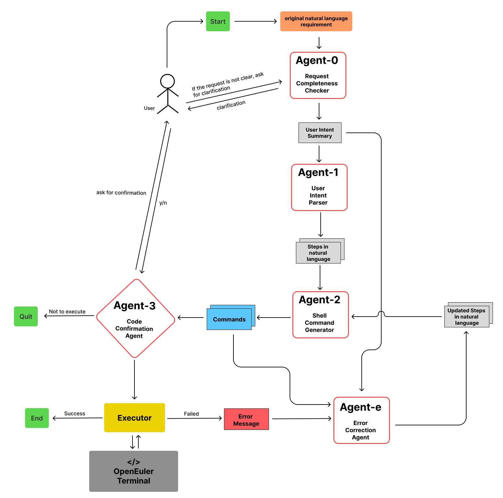
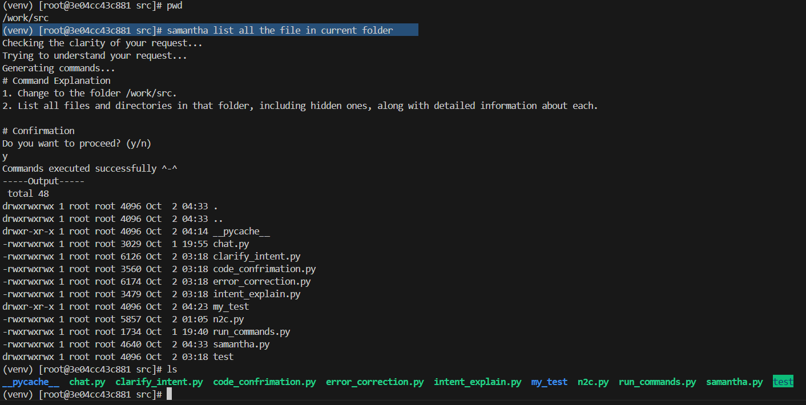
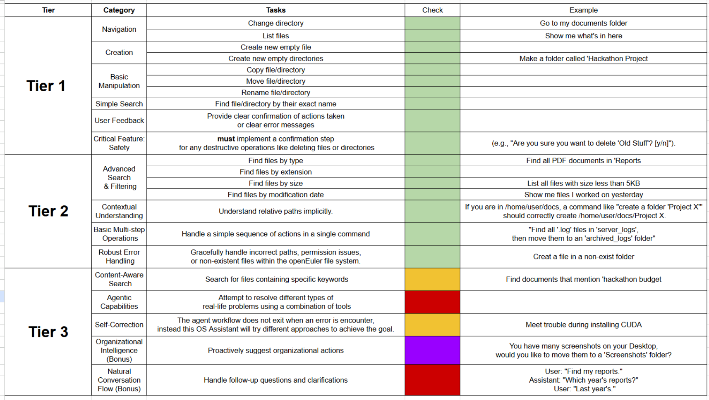
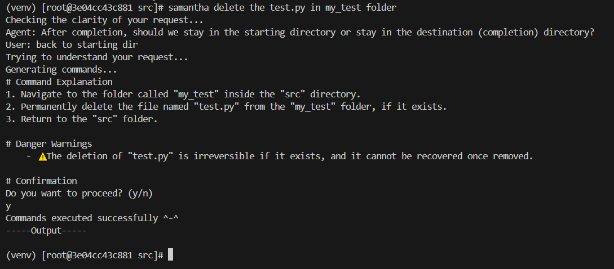
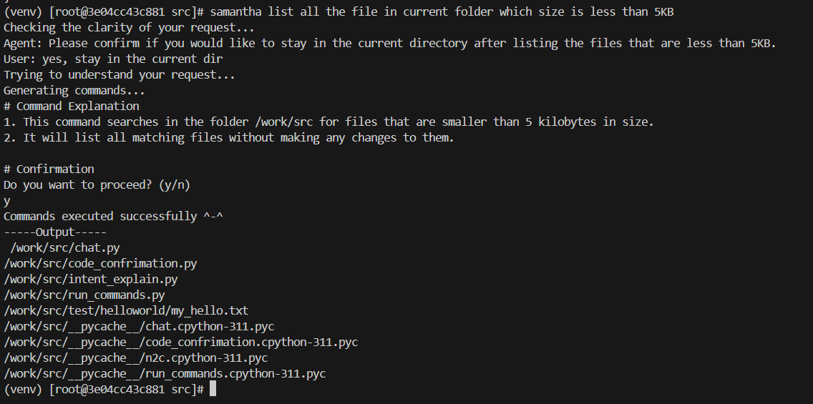
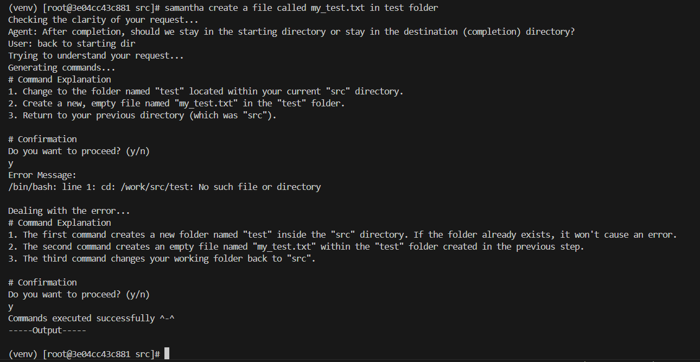
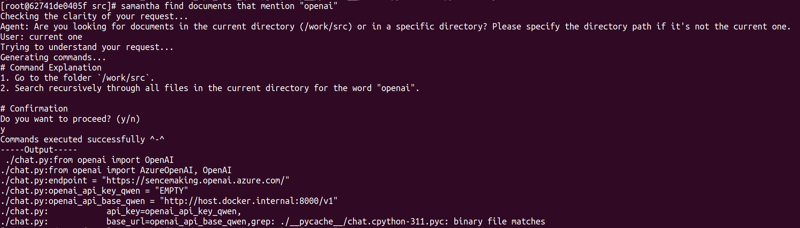
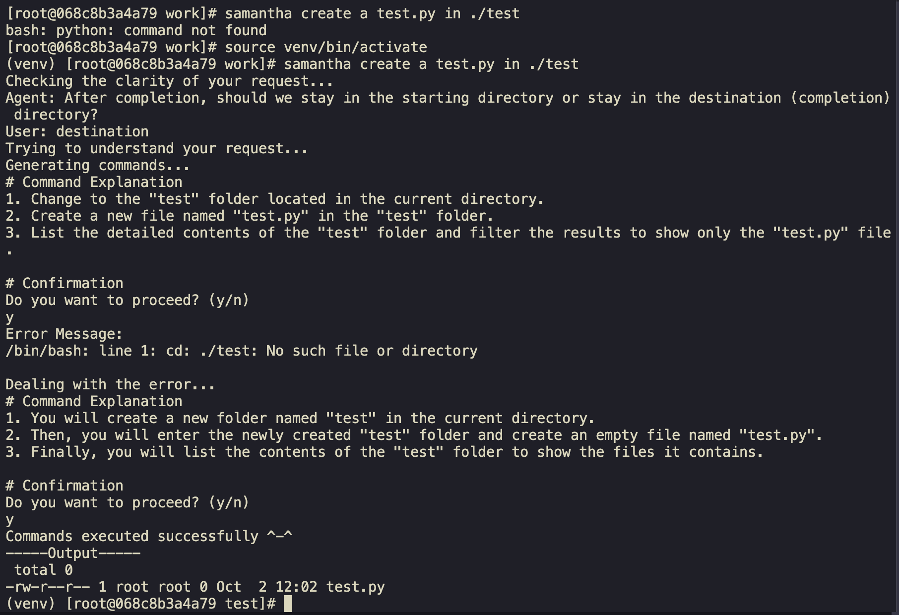
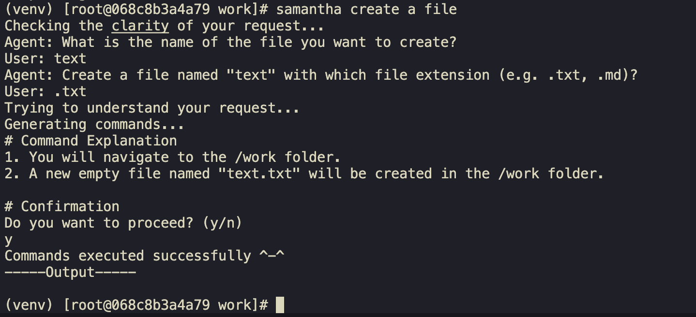
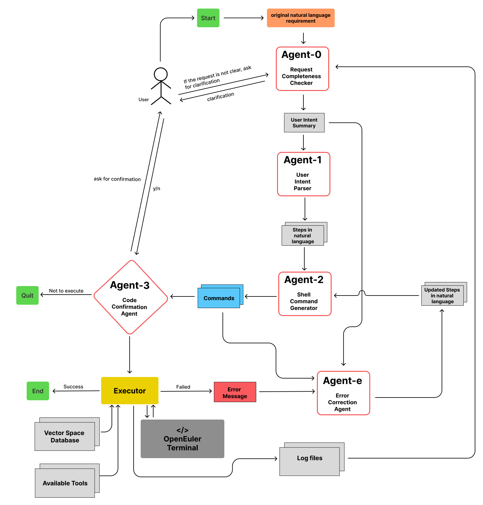

# 早期终端演示与设计记录

[English home](../README.md) · [返回中文首页](../README.zh-CN.md)

本页保留原 README 的设计图和终端截图，用于回顾 NottingDuck 的 openEuler 自然语言终端助手项目。它们展示早期 Bash 模式，不代表当前 Web 控制台、持久任务架构或最新模型验收结果。当前实现见[项目首页](../README.zh-CN.md)、[LangGraph 工作流](langgraph_workflow.md)与[文件任务 Agent 指南](durable_task_agent.md)。

## 早期角色架构

早期设计以 Agent-0 请求检查、Agent-1 意图解析、Agent-2 命令生成、Agent-3 解释 / 审阅和 Agent-e 纠错组织终端交互。当前 Bash 模式已由 LangGraph 编排，并在命令执行前进行独立审阅和人工确认；新的文件任务 Agent 使用独立的持久状态机。

## 终端入口

通过 Shell 函数直接输入 `samantha` 与自然语言请求，省去手动调用 Python 脚本的步骤。当前设置方法见[Shell 函数指南](use_shell_function.md)。

## 早期 Tier 功能演示

这些截图用于展示当时的交互方式，不能作为当前版本的完整功能覆盖或成功率证明。最新验证结果见[2026-10-13 验证记录](task_agent_validation_20261013.md)。

### 文件操作与确认

删除前由用户确认的历史示例。当前文件任务 Agent 不提供删除工具；Bash 模式在执行命令前仍需人工确认。

### 筛选与错误处理

### 内容搜索、纠错与澄清

## 早期扩展设想

图中部分设想现已实现，包括 Qdrant 内容检索、LangGraph 编排，以及新文件任务模式的 SQLite 状态与恢复。后续计划以[首页路线图](../README.zh-CN.md#当前限制与路线图)为准。
